<p align="center">
  <a href="https://blobscape.dev/">
    <picture>
      <source media="(prefers-color-scheme: dark)" srcset=".github/readme/logo-dark.svg" />
      
    </picture>
  </a>
</p>

<h3 align="center">Learn 3D Gaussian splats by taking them apart.</h3>

<p align="center">
  Twenty hands-on lessons, a sandbox, and a shelf of experiments on our own animated-splat engine.<br />
  All of it runs in your browser. Free, no account.
</p>

<p align="center">
  <a href="https://blobscape.dev/"><b>Website</b></a> ·
  <a href="https://blobscape.dev/lessons/">Lessons</a> ·
  <a href="https://blobscape.dev/sandbox/">Sandbox</a> ·
  <a href="https://blobscape.dev/experiments/">Experiments</a> ·
  <a href="https://blobscape.dev/engine/">Engine</a> ·
  <a href="https://blobscape.dev/engine/rigged-splats/">Rigged-splat spec</a>
</p>

<p align="center">
  <a href="LICENSE"></a>
  <a href="https://threejs.org/"></a>
  
  <a href="https://blobscape.dev/"></a>
</p>

<p align="center">
  <a href="https://blobscape.dev/experiments/pixel-diorama/">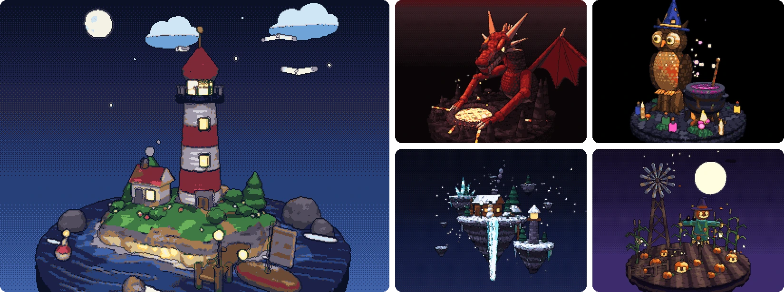</a>
</p>
<p align="center"><sub>Every one of these is real 3D, made of blobs and drawn live as pixel art. <a href="https://blobscape.dev/experiments/pixel-diorama/">Turn them in Pixel Diorama</a>.</sub></p>

## What is a Gaussian splat?

A splat is a 3D scene made of nothing but soft, colored, see-through blobs. Each blob is 14
numbers: where it is, how big it is each way, which way it turns, its color and how solid it is.
Pile up a few million of them, sort them back to front and blend, and you get a photo-real scene
you can walk around. Blobscape teaches that one blob at a time, then shows what else blobs can do
when they are made instead of captured: creatures on bones, worlds that grow, and pixel art that is
still 3D.

<p align="center">
  <a href="https://blobscape.dev/">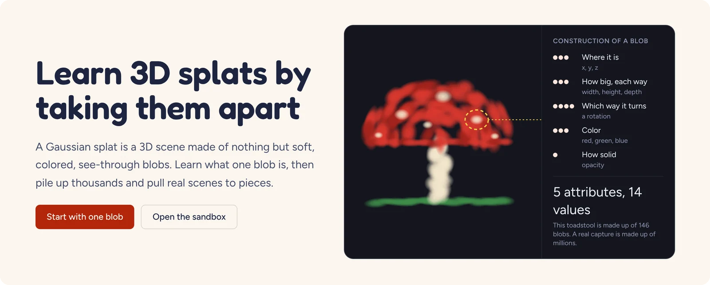</a>
</p>

## Lessons

Every lesson is one question you answer with your hands. Goals tick off as you reach them, each
with a hint that points the way without giving it away, and every scene opens in the sandbox.

| Part | Lessons | What you learn |
| --- | --- | --- |
| **1. One object** | 1–8 | What a blob is, how it lands on screen, why order matters, color by angle, painting, file formats, breaking a scene apart |
| **2. Rigs and 3D models** | 9–16 | Bones, weights, twisting without tearing, a walk cycle, feet on uneven ground, saving a creature as a model, morphs, fur and grass |
| **3. Real things from photos** | 17–20 | Training blobs from photos, fuzzy things meshes can't keep, cleaning up floaters, why lighting is baked |

<p align="center">
  <a href="https://blobscape.dev/lessons/one-blob/">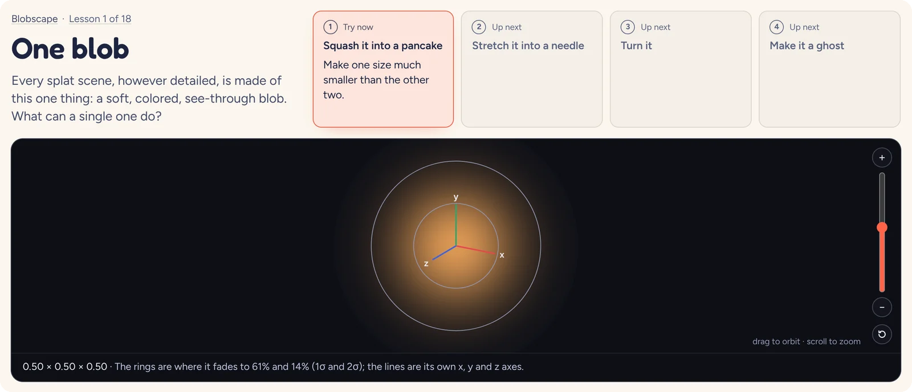</a>
</p>

The [**Sandbox**](https://blobscape.dev/sandbox/) is where you make a mess: spray, select, recolor
and explode blobs, add creatures, or open your own capture (.ply, .spz, .splat, .ksplat, .sog). Files
stay in your browser.

## Experiments

<table>
  <tr>
    <td width="33%" valign="top">
      <a href="https://blobscape.dev/experiments/creature/">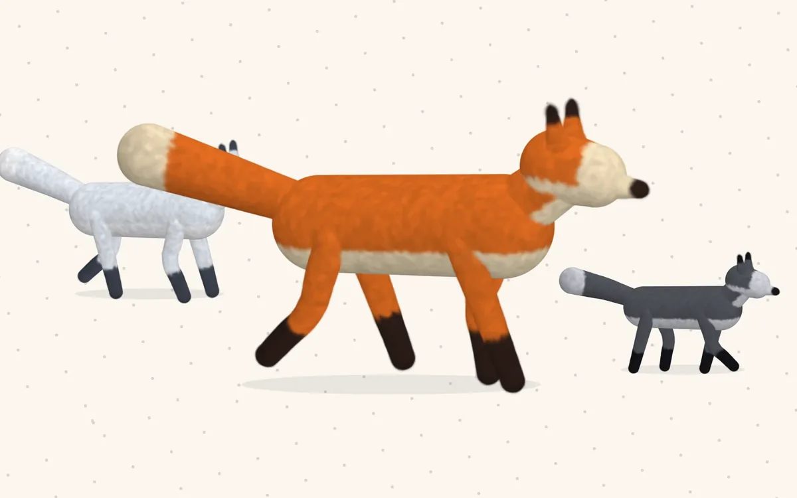</a><br />
      <a href="https://blobscape.dev/experiments/creature/"><b>Splat Creatures</b></a><br />
      Creatures made of blobs, moving on bones. Take one away as a rigged .glb or a sprite sheet.
    </td>
    <td width="33%" valign="top">
      <a href="https://blobscape.dev/experiments/pixel-diorama/">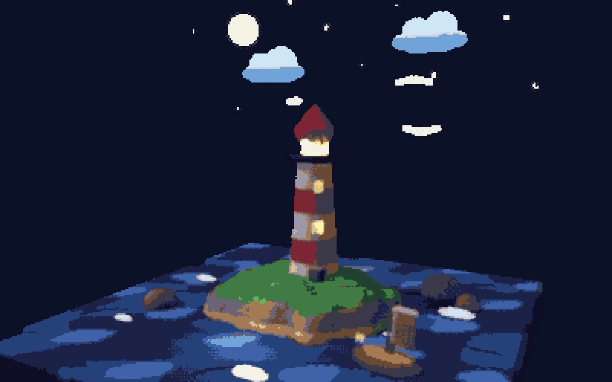</a><br />
      <a href="https://blobscape.dev/experiments/pixel-diorama/"><b>Pixel Diorama</b></a><br />
      Scenes built from shapes and drawn as moving pixel art. Turn them, or switch the pixels off.
    </td>
    <td width="33%" valign="top">
      <a href="https://blobscape.dev/experiments/dungeon-run/">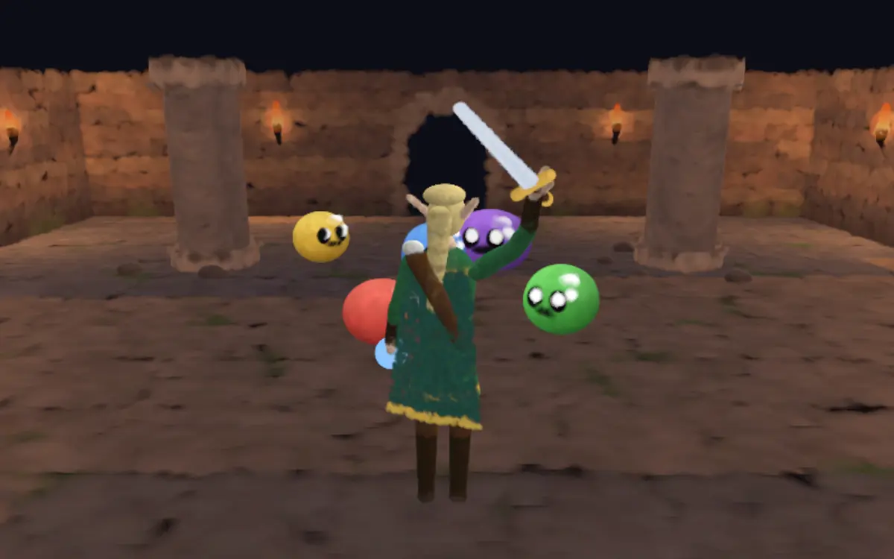</a><br />
      <a href="https://blobscape.dev/experiments/dungeon-run/"><b>Dungeon Run</b></a><br />
      Sword, fire and frost against waves of slimes that burst into splats.
    </td>
  </tr>
  <tr>
    <td valign="top">
      <a href="https://blobscape.dev/experiments/shape-shifter/">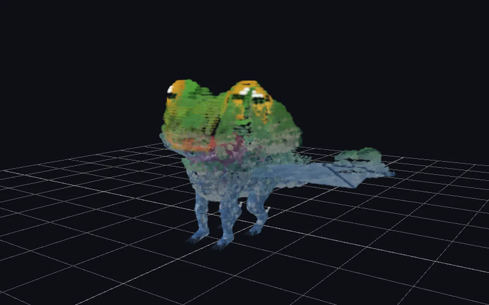</a><br />
      <a href="https://blobscape.dev/experiments/shape-shifter/"><b>Shape Shifter</b></a><br />
      One creature turns into another, every blob traveling to a partner.
    </td>
    <td valign="top">
      <a href="https://blobscape.dev/experiments/forest-walk/">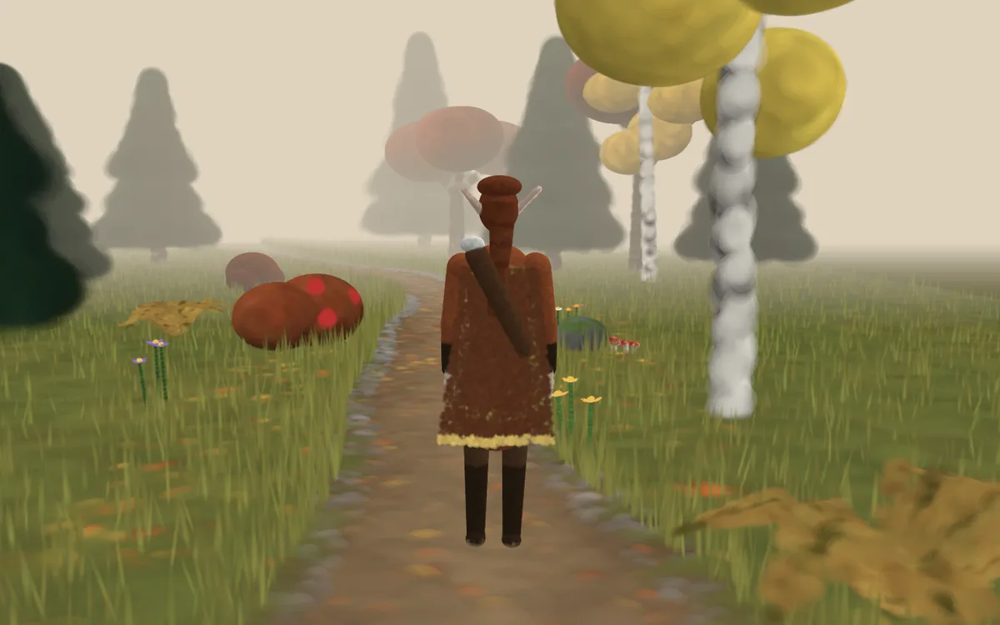</a><br />
      <a href="https://blobscape.dev/experiments/forest-walk/"><b>Forest Walk</b></a><br />
      Walk an endless path while trees and flowers grow out of the ground.
    </td>
    <td valign="top">
      <a href="https://blobscape.dev/experiments/clockwork/">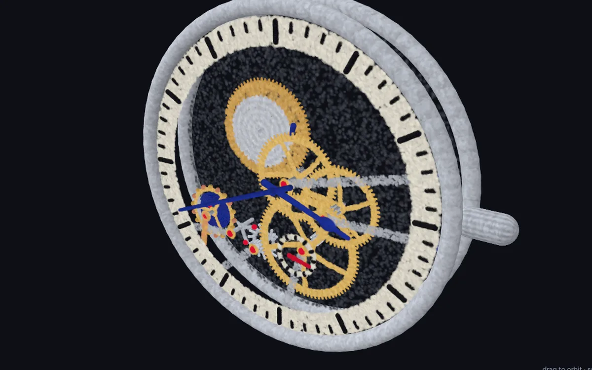</a><br />
      <a href="https://blobscape.dev/experiments/clockwork/"><b>Clockwork</b></a><br />
      A watch movement made of blobs, keeping the real time.
    </td>
  </tr>
  <tr>
    <td valign="top">
      <a href="https://blobscape.dev/experiments/scan-studio/">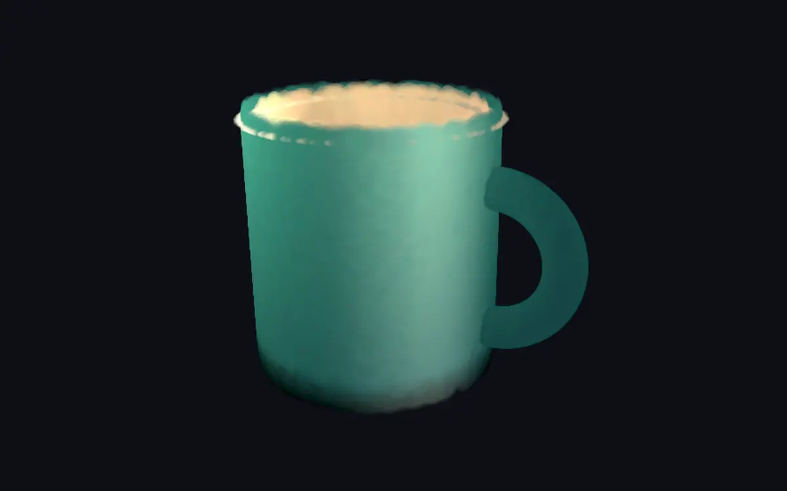</a><br />
      <a href="https://blobscape.dev/experiments/scan-studio/"><b>Scan Studio</b></a><br />
      Clean up a phone scan: level it, cut the table and floaters, relight it.
    </td>
    <td valign="top">
      <a href="https://blobscape.dev/experiments/fit-a-picture/">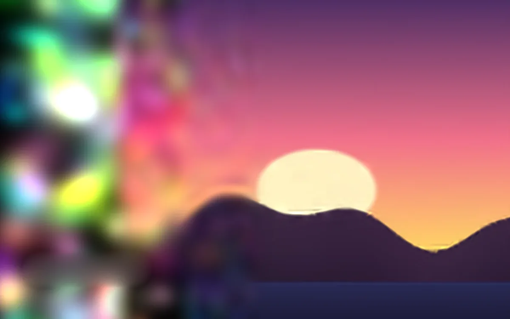</a><br />
      <a href="https://blobscape.dev/experiments/fit-a-picture/"><b>Fit a Picture</b></a><br />
      Watch blobs train themselves into a picture: the splat training loop, in 2D.
    </td>
    <td valign="top">
      <a href="https://blobscape.dev/experiments/splat-to-sprite/">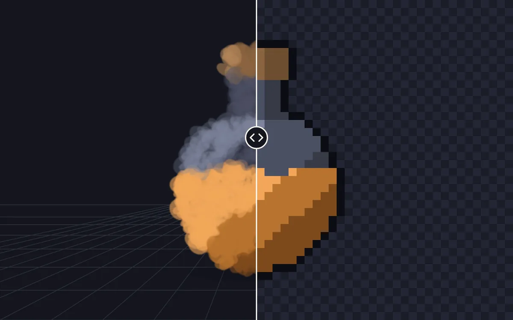</a><br />
      <a href="https://blobscape.dev/experiments/splat-to-sprite/"><b>Splat to Sprite</b></a><br />
      Bake a splat into palette-locked pixel-art sprite sheets.
    </td>
  </tr>
</table>

## The Blobscape engine

Most splat renderers show a place someone captured with a camera. The engine in
[`src/splat-engine`](src/splat-engine) is for splats that are **made, and that move**. It draws
through three.js on WebGPU, with a WebGL 2 fallback, and everything on the site that walks, grows,
ticks or burns uses it.

- **Bones for blobs.** Every blob follows up to four bones, blended on the GPU. Bones turn, slide and grow.
- **One world, one sort.** Every actor shares one set of blobs, sorted together each frame, so a hero, forty slimes and the hall around them overlap correctly.
- **Made, not captured.** Creatures and scenes are written as shapes and cut into blobs with sun and shadows baked in. A whole scene can be [plain data](docs/scene-descriptions.md).
- **Live lights.** Point lights shade the baked colors by distance and facing.
- **Pixel mode.** Palette, dither, outlines, glow and pixels that hold steady while the camera swings. Sprite sheets come from the same pass.
- **Files that travel.** A rigged, animated splat saves as one .glb: the glTF splat extension plus ordinary skins and animation.

For captured rooms, very large scans and headsets, use [Spark](https://github.com/sparkjsdev/spark),
which also draws Blobscape's lessons and sandbox. The two trade files, not a renderer.

The engine is not on npm yet. A three.js package with guides is planned once the showcase settles;
until then, read the source or [get in touch](https://blobscape.dev/contact/) if you want to try it early.

### Rigged splats in glTF

`KHR_gaussian_splatting` stores splats in glTF but says nothing about how a splat's shape follows
its bones. The [rigged-splat spec](docs/rigged-splats.md) (draft, also at
[blobscape.dev/engine/rigged-splats](https://blobscape.dev/engine/rigged-splats/)) settles that with
one rule and no new data. Files that follow it still open in any glTF splat viewer, standing still.
Sample files: [`public/rigged-splats/`](public/rigged-splats).

## Run it locally

Needs Node 22.12 or newer (the tests and scripts run TypeScript directly).

```sh
git clone https://github.com/mtblck/blobscape.git
cd blobscape
npm install
npm run dev          # http://localhost:5173/
```

| Command | What it does |
| --- | --- |
| `npm test` | Unit tests in Node, no GPU: the pixel pipeline, the trainers, and the engine's rig, file and scene math |
| `npm run build` | Hosting check, type check, Vite build to `dist`, then a prerendered HTML file for every page |
| `npm run preview` | Serve the build with the production headers |
| `npm run verify` | Real Chromium against `dist` under the production CSP, with axe accessibility checks (all of them; `-- --changed` runs only those a change reaches) |
| `npm run check` | Unit tests, build, then the browser checks the branch's changes reach: run this before merging ([testing](docs/testing.md)) |

## How the repo is laid out

```
src/
  blobscape/      the site: pages, lessons, sandbox and experiments
  splat-engine/   the animated-splat engine (WebGPU + WebGL 2, on three.js)
  splat-core/     shared splat pieces: blobs, pixel pipeline, color, file reading
  shared/         header, footer, theme, controls and the experiment layout
  fit-a-picture/  the 2D trainer
  splat-to-sprite/
api/              the contact form's serverless function
scripts/          prerender, hosting check and browser verify
docs/             design notes, the engine note, the rigged-splat spec, scene descriptions
```

Further reading: [design notes](docs/design-notes.md) ·
[engine prototype](docs/engine-prototype.md) ·
[writing a scene as data](docs/scene-descriptions.md) ·
[testing](docs/testing.md).

## Thanks

Pixel Diorama was inspired by the pixel-art Gaussian splat scenes that
[Silicon Jungle](https://x.com/JungleSilicon) shared: the idea of drawing voxel scenes as small solid
blobs and cutting them to a palette, and the themes of several scenes. The scenes, the engine and the
code here are our own.

Blobscape stands on [three.js](https://threejs.org/), [Spark](https://sparkjs.dev/) and the
[3D Gaussian Splatting](https://repo-sam.inria.fr/fungraph/3d-gaussian-splatting/) paper by Kerbl
et al.

## License

[MIT](LICENSE) © Matt Black
